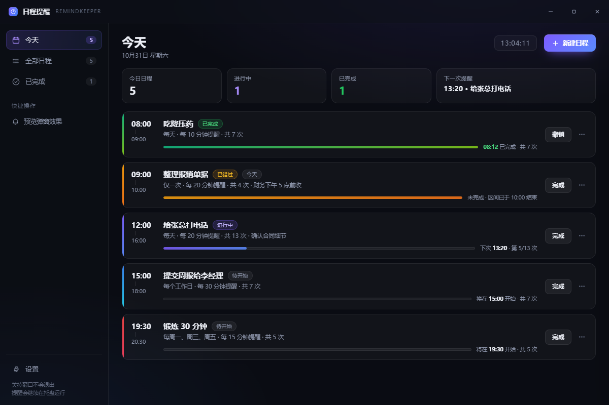
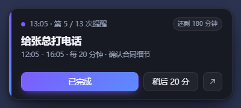
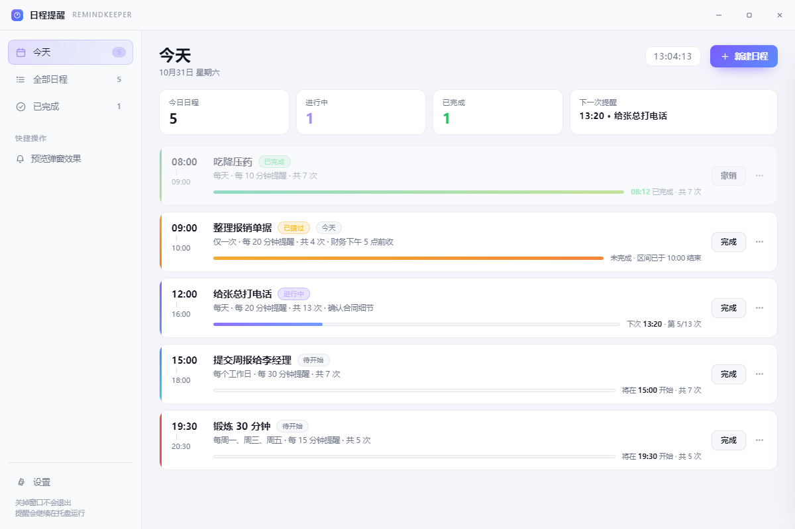
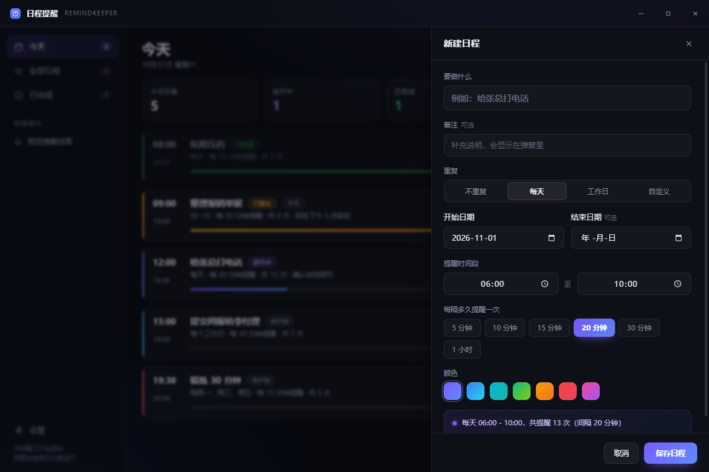

# 日程提醒 · RemindKeeper

一个常驻右下角的轻量日程提醒器。到点从屏幕右下角滑出提示窗，**直到你亲手点「完成」才会停**。

基于 Electron，界面是原生 HTML/CSS/JS，无框架、无网络请求，数据全在本机。

## 界面预览

| 主界面（深色） | 右下角提醒弹窗 |
|---|---|
|  |  |

| 主界面（浅色） | 新建日程 |
|---|---|
|  |  |

## 它是怎么工作的

一句话：**把一段时间切成若干个提醒点，每个点到了就弹一次。**

比如你设「明天 06:00 - 10:00，每 20 分钟提醒一次，给某某某打电话」：

```
06:00  第一次弹窗  →  没理它
06:20  再弹一次    →  还是没理
06:40  再弹一次    →  你点了「完成」 ✅ 今天这件事结束
```

- 10:00 之前只要没点完成，就会一直每 20 分钟提醒一次
- 提醒窗口不会叠一堆，同一个日程只有一个窗口，新的一次会把旧的内容刷新
- 电脑睡眠 / 关机错过好几个时间点，唤醒后只补弹一次，不会一下炸出十几个窗

## 界面

- **今天**：今天要做的（含正在进行的）
- **全部日程**：所有规则
- **已完成**：今天完成掉的

每张卡片会显示：时间区间、间隔、共提醒几次、当前是第几次、下次什么时候提醒、时间进度条。

## 弹窗上的三个按钮

| 按钮 | 作用 |
|---|---|
| **已完成** | 今天这次真正结束，不再提醒。重复日程明天照常 |
| **稍后 20 分** | 这次先不理，20 分钟后再来（间隔可在设置里改） |
| **↗** | 打开主界面对应日程 |

弹窗默认 45 秒后自动收起；超时收起**不等于完成**，下一个时间点还会再弹。可以在设置里改成"常驻"或"20 秒"。

## 时间设置

- **重复**：不重复 / 每天 / 工作日 / 自定义周几
- **时间区间**：比如 06:00 - 10:00。结束早于开始会自动当作跨夜（22:00 - 02:00）
- **提醒间隔**：5 / 10 / 15 / 20 / 30 / 60 分钟，也能自定义任意分钟数
- 新建时默认就是 `06:00 - 10:00，每 20 分钟`

## 托盘

关掉主窗口只会把它收进右下角托盘，提醒继续在后台跑。

- 单击托盘图标 → 打开主界面
- 右键 → 今日待办列表、暂停提醒、开机自启、退出

## 数据存在哪

`%APPDATA%\remind-keeper\data.json`

纯本地文件，不联网、不上传。设置里有「打开数据目录」。

## 运行方式

**打包版**：双击桌面的「日程提醒」，或开始菜单里的快捷方式。

**源码运行**：

```bash
npm install
npm start
```

或双击项目里的 `启动日程提醒.vbs`（不弹黑框）。

## 开机自启

设置 → 开机自动启动。开启后开机静默进入托盘，不弹主窗口。

> 需要在打包安装后的版本里才生效（开发模式下不写注册表）。

## 开发备注

```
main.js              主进程：托盘、单实例、IPC、开机自启
lib/store.js         数据读写（原子写入，防抖）
lib/scheduler.js     调度核心：算时间点、算状态、触发提醒
lib/popup.js         右下角弹窗窗口管理与堆叠布局
renderer/            界面（原生 HTML/CSS/JS，无框架）
tools/gen-icon.js    纯代码生成应用图标
tools/shot.js        离屏截图，用来检查 UI
```

调度精度：主进程每 5 秒 tick 一次；界面每 3 秒拉一次快照，只更新变化的局部，不会闪。
